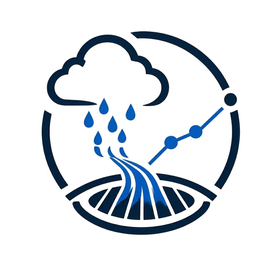

<picture>
  <source media="(max-width: 600px)" srcset="assets/profile/header-ar-mobile.png">
  
</picture>

  
  
  
  

  
  
  

<a href="#profile">نبذة</a> &nbsp;·&nbsp; <a href="#experience">الخبرات</a> &nbsp;·&nbsp; <a href="#toolkit">برامج العمل</a> &nbsp;·&nbsp; <a href="#my-software">برمجياتي</a> &nbsp;·&nbsp; <a href="#portfolio">المشروعات والتدريب</a> &nbsp;·&nbsp; <a href="#contact">تواصل</a>

##  نبذة مهنية

أخصائي نظم معلومات جغرافية وشبكات تصريف الأمطار بخبرة **تتجاوز ٥ سنوات** في GIS للبنية التحتية، وإعداد شبكات الأمطار وخفض المياه الجوفية باستخدام InfraWizard، وتحويل CAD إلى GIS، والرسم الهيدرولوجي والتسليمات الهندسية. خبرة في **مصر والسعودية، وخاصة مشاريع جدة**. مساعد خبير مسجل بالهيئة العامة للتخطيط العمراني ومؤلف **ستة أطالس جغرافية**.

أستخدم **البرمجة بمساعدة الذكاء الاصطناعي** لتطوير أدوات GIS وبرامج سطح المكتب وتطبيقات أندرويد ولوحات الويب.

##  الخبرة والتعليم

<table width="100%">
<thead><tr><th align="right">الفترة</th><th align="right">الخبرة / المؤهل</th></tr></thead>
<tbody>
<tr><td width="165">أكتوبر ٢٠٢١ – ديسمبر ٢٠٢٤</td><td><strong>أخصائي نظم معلومات جغرافية ورسم هيدرولوجي</strong> Vision Dimensions Engineering Consultancy</td></tr>
<tr><td width="165">يناير ٢٠٢٠ – أكتوبر ٢٠٢١</td><td><strong>أخصائي نظم معلومات جغرافية مستقل</strong> عمل حر</td></tr>
<tr><td width="165">مايو ٢٠١٨</td><td><strong>ليسانس الجغرافيا والخرائط ونظم المعلومات الجغرافية</strong> كلية الآداب، جامعة القاهرة</td></tr>
</tbody></table>

##  البرامج التي أستخدمها

برامج العمل الواردة في سيرتي الذاتية. يشمل استخدام SewerGEMS وStormCAD **تجهيز البيانات الهندسية**.

### نظم المعلومات الجغرافية والخرائط

  
  
  
  
  
  
  

### الرسم الهندسي وتجهيز بيانات الشبكات

  
  
  
  
  
  

### الأعمال المكتبية

  

### مهارات تقنية إضافية

  
  
  

##  برامج وتولز طوّرتها بمساعدة الذكاء الاصطناعي

مشروعاتي البرمجية وأدواتي المطوّرة بمساعدة الذكاء الاصطناعي، مع نطاق كل مشروع ورابط مستودعه. حالة التطوير موضحة ضمن وصف المشروع.

### نظم المعلومات الجغرافية والهيدرولوجيا والخرائط

<table width="100%">
<thead><tr><th align="right">المشروع · نطاق العمل · المستودع</th></tr></thead>
<tbody>
<tr><td align="right">
&nbsp; <a href="https://github.com/ahmadibrahim4geo/MIRSAD"><strong>MIRSAD</strong></a>

صناديق أدوات لـArcMap وArcGIS Pro لاختيار محطات الرصد وحساب المؤشرات المناخية والاستيفاء المكاني وإنتاج الأطالس، تشمل 19 حزمة مناخية ونسخة تطوير لتطبيق Windows مستقل ثنائي اللغة. تطبيق سطح المكتب تحت التطوير.
</td></tr>
<tr><td align="right">
<a href="https://github.com/ahmadibrahim4geo/Create-FlowArrow-Tool"><strong>CreateFlowArrow</strong></a>

إنشاء أسهم السريان وحساب الميول من مناسيب القاع وفحص الاتجاهات والاتصالية لشبكات الأمطار والصرف والنزح، مع إمكانية تصحيح المواسير المعكوسة.
</td></tr>
<tr><td align="right">
<a href="https://github.com/ahmadibrahim4geo/GeologicalCrossSectionToolbox"><strong>Geological Cross-Section Toolbox</strong></a>

إنتاج قطاعات ثنائية الأبعاد من المكاشف والفوالق وبيانات الارتفاع المحلية أو المتاحة عبر الإنترنت، مع المعالجة المجمعة ومخرجات قواعد البيانات وDXF وHTML والجداول.
</td></tr>
<tr><td align="right">
&nbsp; <a href="https://github.com/ahmadibrahim4geo/GeoVision"><strong>GeoVision</strong></a>

عرض ملفات المتجهات والراستر المحلية، ومنها Shapefile وGeoJSON وKML وGeoPackage وGeoTIFF، بواجهتين عربية وإنجليزية وسير عمل للبيانات دون اتصال.
</td></tr>
<tr><td align="right">
&nbsp; <a href="https://github.com/ahmadibrahim4geo/Storm_Drainage_Calculation_dashboard"><strong>Storm Drainage Calculation Dashboard</strong></a>

علاقات IDF والجريان بطريقة SCS Curve Number وتوزيعات أمطار التصميم والتصرف الأقصى بالطريقة العقلانية، مع الرسوم البيانية وتصدير CSV وتقارير قابلة للطباعة.
</td></tr>
<tr><td align="right">
<a href="https://github.com/ahmadibrahim4geo/GIS-Style-Collection"><strong>GIS Style Collection</strong></a>

مجموعة ستايلات منظمة في 27 تصنيفًا، مع بحث ثنائي اللغة ونسخ عربية وسكربتات ترجمة للجيولوجيا والهيدرولوجيا والتربة واستخدامات الأرض والبنية التحتية.
</td></tr>
<tr><td align="right">
<a href="https://github.com/ahmadibrahim4geo/gis-data-repositories-professional-2026"><strong>GIS Data Repositories Professional 2026</strong></a>

دليل يضم أكثر من 2,660 مصدرًا لبيانات GIS، مع بحث ثنائي اللغة وفلاتر تصنيف وفحص روابط المصادر ومستكشف خرائط وتصدير منظم للبيانات.
</td></tr>
<tr><td align="right">
&nbsp; <a href="https://github.com/ahmadibrahim4geo/GIS-Development-Skills"><strong>GIS Development Skills</strong></a>

حزمة مهارات ثنائية اللغة لتطوير GIS ومعالجة البيانات المكانية وتكامل واجهات API، مع توجيه للتخصصات وأمثلة قابلة لإعادة التشغيل والتحقق القائم على الأدلة.
</td></tr>
<tr><td align="right">
&nbsp; <a href="https://github.com/ahmadibrahim4geo/Z-EARTH"><strong>Z EARTH</strong></a>

مشروع GIS لتطبيق Windows يدعم KML/KMZ وإدارة الأماكن والطبقات والخرائط ثنائية وثلاثية الأبعاد. المصدر ومعاينة محمولة متاحان، ويستمر العمل على الاستقرار. تحت التطوير.
</td></tr>
<tr><td align="right">
&nbsp; <strong>Atlas of Egyptian Curriculums Maps App</strong>

تطبيق خرائط تم تطويره لأطلس المناهج المصرية وسير عمل إعداد الخرائط. مشروع محلي · دون رابط مستودع.
</td></tr>
</tbody>
</table>

### تطبيقات سطح المكتب وأندرويد

<table width="100%">
<thead><tr><th align="right">المشروع · نطاق العمل · المستودع</th></tr></thead>
<tbody>
<tr><td align="right">
&nbsp; <a href="https://github.com/ahmadibrahim4geo/SmartCalculator"><strong>SmartCalculator</strong></a>

أعداد مركبة وإحصاء وحل معادلات ومصفوفات ومتجهات وتحويل أنظمة العد وجداول دوال، مع وضع مصغر وحفظ التفضيلات.
</td></tr>
<tr><td align="right">
&nbsp; <a href="https://github.com/ahmadibrahim4geo/SmartPhotoOrganizer"><strong>SmartPhotoOrganizer</strong></a>

مراجعة بيانات EXIF وGPS واكتشاف المكررات وتقييم جودة الصور وإعادة التسمية المجمعة والعرض على الخرائط وتقارير CSV وPDF.
</td></tr>
<tr><td align="right">
&nbsp; <a href="https://github.com/ahmadibrahim4geo/RoboTransfer"><strong>RoboTransfer</strong></a>

نسخ وتحديث ومزامنة مرآتية ونقل الملفات، مع معاينة تجريبية ومتابعة التقدم وملخصات النقل وسجلات Unicode.
</td></tr>
<tr><td align="right">
&nbsp; <a href="https://github.com/ahmadibrahim4geo/DropAndCopy"><strong>DropAndCopy</strong></a>

تجميع الملفات بالسحب والإفلات ونسخها ونقلها، مع معالجة تعارض الأسماء تلقائيًا وإمكانية حفظ بنية المجلدات ومتابعة التقدم.
</td></tr>
<tr><td align="right">
&nbsp; <a href="https://github.com/ahmadibrahim4geo/ChargeAlert"><strong>Charge Alert</strong></a>

تنبيهات قابلة للضبط عند الوصول لنسبة شحن محددة، ومراقبة في الخلفية وواجهتان عربية وإنجليزية وتصميمات شحن متعددة.
</td></tr>
<tr><td align="right">
&nbsp; <a href="https://github.com/ahmadibrahim4geo/FitraShield"><strong>FitraShield</strong></a>

تصفية محلية للمحتوى وقوائم حظر وسماح مخصصة وتقارير أبوية ومساعد Windows لتكامل سياسات المتصفح.
</td></tr>
</tbody>
</table>

### ملف الأعمال المهني

<table width="100%">
<thead><tr><th align="right">المشروع · نطاق العمل · المستودع</th></tr></thead>
<tbody>
<tr><td align="right">
&nbsp; <a href="https://github.com/ahmadibrahim4geo/ahmadibrahim4geo"><strong>Ahmad Ibrahim Portfolio</strong></a>

ملف أعمال عربي وإنجليزي متجاوب يعرض مشاريع البنية التحتية والأطالس المسجلة والمنشورات والقدرات المهنية ومستودعات البرمجيات.
</td></tr>
</tbody>
</table>

### تقنيات البرمجة بمساعدة الذكاء الاصطناعي

أستخدم أدوات الذكاء الاصطناعي للمساعدة في كتابة الأكواد وتعديلها باستخدام التقنيات التالية:

<code>Python / ArcPy</code> · <code>C# / .NET / WPF</code> · <code>Kotlin / Jetpack Compose</code> · <code>JavaScript / HTML / CSS</code> · <code>Git / GitHub</code> · <code>Desktop installers</code> · <code>GIS data services</code>

##  المشروعات والمؤلفات والتدريب

استعرض المشروعات الهندسية والخبرات والأطالس الجغرافية الستة المسجلة، وتعرّف على الدورات مصنفة حسب الجهة المانحة.

  
  
  
  

##  التواصل

<picture>
  <source media="(max-width: 600px)" srcset="assets/profile/contact-ar-mobile.svg">
  
</picture>

الجيزة، مصر · خبرة مشروعات في مصر والسعودية

  
  
  
  

<a href="mailto:ahmadibrahim.geo@gmail.com">ahmadibrahim.geo@gmail.com</a>

توثيق الموقع ومصادر الشعارات

<a href="PORTFOLIO.md">توثيق تشغيل الموقع</a> · <a href="https://ahmadibrahim4geo.github.io/ahmadibrahim4geo/assets/credits.html">مصادر الأصول والشعارات</a>

