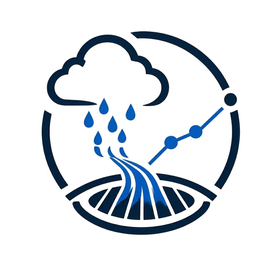

<picture>
  <source media="(max-width: 600px)" srcset="assets/profile/header-en-mobile.png">
  
</picture>

  
  
  
  

  
  
  

<a href="#profile">Profile</a> &nbsp;·&nbsp; <a href="#experience">Experience</a> &nbsp;·&nbsp; <a href="#toolkit">My toolkit</a> &nbsp;·&nbsp; <a href="#my-software">My software</a> &nbsp;·&nbsp; <a href="#portfolio">Projects & training</a> &nbsp;·&nbsp; <a href="#contact">Contact</a>

##  Professional profile

GIS and stormwater network specialist with **5+ years of experience** in infrastructure GIS, InfraWizard-based stormwater and groundwater reduction networks, CAD-to-GIS conversion, hydrological drafting and engineering deliverables. Project experience in **Egypt and Saudi Arabia, especially Jeddah**. Registered **GOPP Expert Assistant** and author of **six geographic atlases**.

I use **AI-assisted programming** to develop GIS tools, desktop utilities, Android applications and web dashboards.

##  Experience & education

<table width="100%">
<thead><tr><th align="left">Period</th><th align="left">Experience / qualification</th></tr></thead>
<tbody>
<tr><td width="165">Oct 2021 – Dec 2024</td><td><strong>GIS Specialist &amp; Hydrological Drafting Specialist</strong> Vision Dimensions Engineering Consultancy</td></tr>
<tr><td width="165">Jan 2020 – Oct 2021</td><td><strong>Freelance GIS Specialist</strong> Independent practice</td></tr>
<tr><td width="165">May 2018</td><td><strong>B.A. Geography, Maps &amp; Geographic Information Systems</strong> Faculty of Arts, Cairo University</td></tr>
</tbody></table>

##  Software I use

My working software, as listed in my CV. SewerGEMS / StormCAD work covers **engineering data preparation**.

### GIS & mapping

  
  
  
  
  
  
  

### Engineering, drafting & network data

  
  
  
  
  
  

### Office & documentation

  

### Additional technical skills

  
  
  

##  Software & tools I developed with AI assistance

My software projects and tools, developed with AI assistance. Each entry includes its scope and repository; development status is stated where applicable.

### GIS, hydrology & cartography

<table width="100%">
<thead><tr><th align="left">Project · scope · repository</th></tr></thead>
<tbody>
<tr><td align="left">
&nbsp; <a href="https://github.com/ahmadibrahim4geo/MIRSAD"><strong>MIRSAD</strong></a>

ArcMap and ArcGIS Pro toolboxes for station selection, climate indicators, spatial interpolation and atlas outputs. Includes 19 climate modules and a bilingual Windows desktop development build. Desktop in development.
</td></tr>
<tr><td align="left">
<a href="https://github.com/ahmadibrahim4geo/Create-FlowArrow-Tool"><strong>CreateFlowArrow</strong></a>

Flow arrows, invert-based slope calculations, direction and connectivity checks for stormwater, sewer and dewatering networks, with optional correction of reversed pipes.
</td></tr>
<tr><td align="left">
<a href="https://github.com/ahmadibrahim4geo/GeologicalCrossSectionToolbox"><strong>Geological Cross-Section Toolbox</strong></a>

Automated 2D sections from outcrops, faults and local or online elevation data. Supports batch processing and geodatabase, DXF, HTML and tabular outputs.
</td></tr>
<tr><td align="left">
&nbsp; <a href="https://github.com/ahmadibrahim4geo/GeoVision"><strong>GeoVision</strong></a>

Local vector and raster viewing for Shapefile, GeoJSON, KML, GeoPackage and GeoTIFF, with Arabic and English interfaces and offline data workflows.
</td></tr>
<tr><td align="left">
&nbsp; <a href="https://github.com/ahmadibrahim4geo/Storm_Drainage_Calculation_dashboard"><strong>Storm Drainage Calculation Dashboard</strong></a>

IDF relationships, SCS Curve Number runoff, design rainfall distributions and Rational Method peak discharge, with charts, CSV export and printable reports.
</td></tr>
<tr><td align="left">
<a href="https://github.com/ahmadibrahim4geo/GIS-Style-Collection"><strong>GIS Style Collection</strong></a>

A curated collection across 27 categories, with bilingual search, Arabic style variants and translation scripts for geology, hydrology, soils, land use and infrastructure.
</td></tr>
<tr><td align="left">
<a href="https://github.com/ahmadibrahim4geo/gis-data-repositories-professional-2026"><strong>GIS Data Repositories Professional 2026</strong></a>

A catalog of 2,660+ GIS data sources with bilingual search, category filters, source-link audits, a map explorer and structured exports.
</td></tr>
<tr><td align="left">
&nbsp; <a href="https://github.com/ahmadibrahim4geo/GIS-Development-Skills"><strong>GIS Development Skills</strong></a>

A bilingual skill suite covering GIS development, spatial pipelines and API integrations, with specialist routing, reproducible examples and evidence-based verification.
</td></tr>
<tr><td align="left">
&nbsp; <a href="https://github.com/ahmadibrahim4geo/Z-EARTH"><strong>Z EARTH</strong></a>

A Windows GIS development project for KML/KMZ, Places and Layers management and 2D/3D mapping. Source and a portable preview are available; stabilization remains in progress. In development.
</td></tr>
<tr><td align="left">
&nbsp; <strong>Atlas of Egyptian Curriculums Maps App</strong>

A maps application developed for Egyptian curriculum atlas and map workflows. Local project · no repository link.
</td></tr>
</tbody>
</table>

### Desktop & Android utilities

<table width="100%">
<thead><tr><th align="left">Project · scope · repository</th></tr></thead>
<tbody>
<tr><td align="left">
&nbsp; <a href="https://github.com/ahmadibrahim4geo/SmartCalculator"><strong>SmartCalculator</strong></a>

Complex numbers, statistics, equation solving, matrices, vectors, number-base conversion and function tables, with compact mode and persistent preferences.
</td></tr>
<tr><td align="left">
&nbsp; <a href="https://github.com/ahmadibrahim4geo/SmartPhotoOrganizer"><strong>SmartPhotoOrganizer</strong></a>

EXIF/GPS metadata review, duplicate detection, image-quality assessment, bulk renaming, map browsing and CSV/PDF reporting.
</td></tr>
<tr><td align="left">
&nbsp; <a href="https://github.com/ahmadibrahim4geo/RoboTransfer"><strong>RoboTransfer</strong></a>

Copy, update, mirror and move workflows, with dry-run previews, live progress, transfer summaries and Unicode logs.
</td></tr>
<tr><td align="left">
&nbsp; <a href="https://github.com/ahmadibrahim4geo/DropAndCopy"><strong>DropAndCopy</strong></a>

Drag-and-drop file collection, copy and move operations, automatic conflict renaming, optional folder-structure preservation and progress tracking.
</td></tr>
<tr><td align="left">
&nbsp; <a href="https://github.com/ahmadibrahim4geo/ChargeAlert"><strong>Charge Alert</strong></a>

Configurable charge-target alerts, background monitoring, Arabic and English interfaces and selectable charging designs.
</td></tr>
<tr><td align="left">
&nbsp; <a href="https://github.com/ahmadibrahim4geo/FitraShield"><strong>FitraShield</strong></a>

Local content filtering, custom block and allow lists, parental reporting and a Windows helper for browser-policy integration.
</td></tr>
</tbody>
</table>

### Professional portfolio

<table width="100%">
<thead><tr><th align="left">Project · scope · repository</th></tr></thead>
<tbody>
<tr><td align="left">
&nbsp; <a href="https://github.com/ahmadibrahim4geo/ahmadibrahim4geo"><strong>Ahmad Ibrahim Portfolio</strong></a>

A responsive English and Arabic portfolio presenting infrastructure projects, registered atlases, publications, professional capabilities and software repositories.
</td></tr>
</tbody>
</table>

### AI-assisted programming technologies

I use AI tools to help write and adapt code with the following technologies:

<code>Python / ArcPy</code> · <code>C# / .NET / WPF</code> · <code>Kotlin / Jetpack Compose</code> · <code>JavaScript / HTML / CSS</code> · <code>Git / GitHub</code> · <code>Desktop installers</code> · <code>GIS data services</code>

##  Projects, publications & training

Explore infrastructure projects, professional experience, six registered geographic atlases and courses grouped by issuer.

  
  
  
  

##  Contact

<picture>
  <source media="(max-width: 600px)" srcset="assets/profile/contact-en-mobile.svg">
  
</picture>

Giza, Egypt · Project experience in Egypt &amp; Saudi Arabia

  
  
  
  

<a href="mailto:ahmadibrahim.geo@gmail.com">ahmadibrahim.geo@gmail.com</a>

Website documentation & asset credits

<a href="PORTFOLIO.md">Website maintenance documentation</a> · <a href="https://ahmadibrahim4geo.github.io/ahmadibrahim4geo/assets/credits.html">Asset sources & credits</a>

