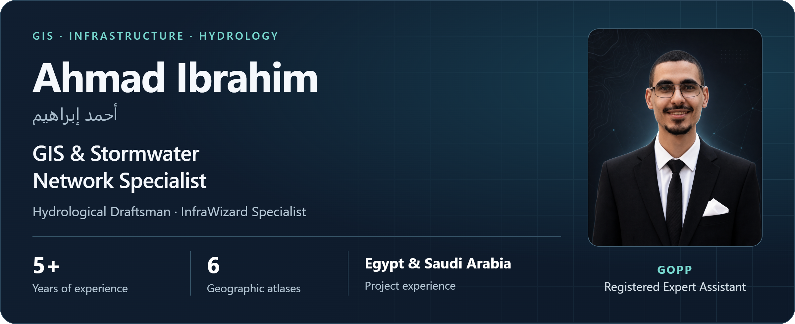

<picture>
  <source media="(max-width: 600px)" srcset="assets/profile/header-en-mobile.png">
  
</picture>

  
  
  
  

  
  
  

## Professional profile

GIS and stormwater network specialist with 5+ years of experience in infrastructure GIS, InfraWizard-based stormwater and groundwater reduction networks, CAD-to-GIS conversion, hydrological drafting and engineering deliverables. Project experience in Egypt and Saudi Arabia, especially Jeddah. Registered GOPP Expert Assistant and author of six geographic atlases.

I use AI-assisted programming to develop GIS tools, desktop utilities, Android applications and web dashboards. My working software is listed separately from the software and tools I developed.

## Experience and education

- Vision Dimensions Engineering Consultancy: GIS Specialist and Hydrological Drafting Specialist, October 2021 - December 2024.
- Freelance GIS Specialist, January 2020 - October 2021.
- B.A. Geography, Maps and Geographic Information Systems, Faculty of Arts, Cairo University, May 2018.

## Software I use

InfraWizard, ArcMap ArcGIS Desktop, ArcGIS Pro, QGIS, Global Mapper, AutoCAD, Civil 3D, SewerGEMS / StormCAD data preparation, SAS Planet, Microsoft Office Suite, Google Earth Pro, Google Earth Engine, Payazed Menu.

### Additional technical skills

Adobe Illustrator, Photoshop, and InDesign.

## Software and tools I developed with AI assistance

| Project | Description | Link |
| --- | --- | --- |
| MIRSAD | ArcMap and ArcGIS Pro toolboxes for station selection, climate indicators, spatial interpolation and atlas outputs. Includes 19 climate modules and a bilingual Windows desktop development build. Desktop in development. | [GitHub](https://github.com/ahmadibrahim4geo/MIRSAD) |
| CreateFlowArrow | Flow arrows, invert-based slope calculations, direction and connectivity checks for stormwater, sewer and dewatering networks, with optional correction of reversed pipes. | [GitHub](https://github.com/ahmadibrahim4geo/Create-FlowArrow-Tool) |
| Geological Cross-Section Toolbox | Automated 2D sections from outcrops, faults and local or online elevation data. Supports batch processing and geodatabase, DXF, HTML and tabular outputs. | [GitHub](https://github.com/ahmadibrahim4geo/GeologicalCrossSectionToolbox) |
| GeoVision | Local vector and raster viewing for Shapefile, GeoJSON, KML, GeoPackage and GeoTIFF, with Arabic and English interfaces and offline data workflows. | [GitHub](https://github.com/ahmadibrahim4geo/GeoVision) |
| Storm Drainage Calculation Dashboard | IDF relationships, SCS Curve Number runoff, design rainfall distributions and Rational Method peak discharge, with charts, CSV export and printable reports. | [GitHub](https://github.com/ahmadibrahim4geo/Storm_Drainage_Calculation_dashboard) |
| GIS Style Collection | A curated collection across 27 categories, with bilingual search, Arabic style variants and translation scripts for geology, hydrology, soils, land use and infrastructure. | [GitHub](https://github.com/ahmadibrahim4geo/GIS-Style-Collection) |
| GIS Data Repositories Professional 2026 | A catalog of 2,660+ GIS data sources with bilingual search, category filters, source-link audits, a map explorer and structured exports. | [GitHub](https://github.com/ahmadibrahim4geo/gis-data-repositories-professional-2026) |
| GIS Development Skills | A bilingual skill suite covering GIS development, spatial pipelines and API integrations, with specialist routing, reproducible examples and evidence-based verification. | [GitHub](https://github.com/ahmadibrahim4geo/GIS-Development-Skills) |
| Z EARTH | A Windows GIS development project for KML/KMZ, Places and Layers management and 2D/3D mapping. Source and a portable preview are available; stabilization remains in progress. In development. | [GitHub](https://github.com/ahmadibrahim4geo/Z-EARTH) |
| Atlas of Egyptian Curriculums Maps App | A maps application developed for Egyptian curriculum atlas and map workflows. Local project · no repository link. | Local project |
| SmartCalculator | Complex numbers, statistics, equation solving, matrices, vectors, number-base conversion and function tables, with compact mode and persistent preferences. | [GitHub](https://github.com/ahmadibrahim4geo/SmartCalculator) |
| SmartPhotoOrganizer | EXIF/GPS metadata review, duplicate detection, image-quality assessment, bulk renaming, map browsing and CSV/PDF reporting. | [GitHub](https://github.com/ahmadibrahim4geo/SmartPhotoOrganizer) |
| RoboTransfer | Copy, update, mirror and move workflows, with dry-run previews, live progress, transfer summaries and Unicode logs. | [GitHub](https://github.com/ahmadibrahim4geo/RoboTransfer) |
| DropAndCopy | Drag-and-drop file collection, copy and move operations, automatic conflict renaming, optional folder-structure preservation and progress tracking. | [GitHub](https://github.com/ahmadibrahim4geo/DropAndCopy) |
| Charge Alert | Configurable charge-target alerts, background monitoring, Arabic and English interfaces and selectable charging designs. | [GitHub](https://github.com/ahmadibrahim4geo/ChargeAlert) |
| FitraShield | Local content filtering, custom block and allow lists, parental reporting and a Windows helper for browser-policy integration. | [GitHub](https://github.com/ahmadibrahim4geo/FitraShield) |
| Ahmad Ibrahim Portfolio | A responsive English and Arabic portfolio presenting infrastructure projects, registered atlases, publications, professional capabilities and software repositories. | [GitHub](https://github.com/ahmadibrahim4geo/ahmadibrahim4geo) |

### AI-assisted programming technologies

Python / ArcPy · C# / .NET / WPF · Kotlin / Jetpack Compose · JavaScript / HTML / CSS · Git/GitHub · Desktop installers · GIS data services.

## Projects, publications and training

[Infrastructure projects](https://ahmadibrahim4geo.github.io/ahmadibrahim4geo/#projects) · [Experience](https://ahmadibrahim4geo.github.io/ahmadibrahim4geo/#experience) · [Six registered geographic atlases](https://ahmadibrahim4geo.github.io/ahmadibrahim4geo/#publications) · [Courses grouped by issuer](https://ahmadibrahim4geo.github.io/ahmadibrahim4geo/#certificates)

## Contact

[Email](mailto:ahmadibrahim.geo@gmail.com) · [LinkedIn](https://www.linkedin.com/in/ahmadibrahim4geo/) · [GitHub](https://github.com/ahmadibrahim4geo)

[Website maintenance and asset documentation](PORTFOLIO.md)
